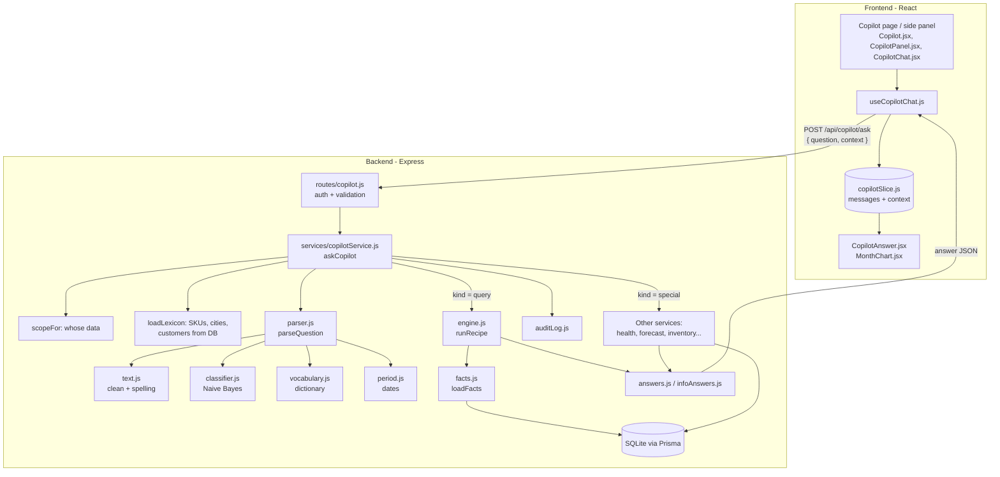

# Dealer Copilot: How It Is Built

A file-by-file guide to the Copilot, the AI assistant in the Dealer App.
For engineers new to the codebase. About 4,200 lines across 20 files.

---

## 1. Summary

The Copilot answers business questions in plain English, for example *"How many furnaces did we
sell this year?"*, *"Top 5 products by profit last year"* or *"Pending claims by status"*. It
answers from the signed-in dealer's own data. Every answer comes with the evidence behind it: the
number of records, the exact dates, and a button to open those records.

**It is built entirely in-house.** It uses no GPT, OpenAI, Claude, external AI API, API key or AI
library. It combines:

| Part | What it does | File |
|---|---|---|
| A **Naive Bayes text classifier** written from scratch | Guesses the topic of a question it has never seen, with a confidence | `classifier.js` |
| A **business dictionary** | Words for metrics, filters, breakdowns, statuses, categories | `vocabulary.js` |
| A **rule-based parser** | Turns the question into a structured **recipe** | `parser.js` |
| **One generic query engine** | Runs any recipe on the dealer's data | `engine.js`, `facts.js` |
| **Answer builders** | Turn the numbers into a sentence, big number, chart, table, evidence, buttons | `answers.js`, `infoAnswers.js` |

The key idea: **the question is turned into a recipe, not into SQL and not into free text.** A recipe
is a small, fixed-shape object (`metric`, `groupBy`, `filters`, `period`, `compare`, `sort`, `limit`).
One engine can run any combination, so a new kind of question usually needs only new dictionary
words, not new code.

---

## 2. Architecture



**The classifier is trained once, when the server starts** (`copilotService.js:70`:
`const model = train(TRAINING_DATA)`). It learns from 114 example questions across 10 topics, which
gives a vocabulary of 132 words. Training takes a few milliseconds.

---

## 3. Life of a question

Example, asked by a dealer user on 25 Nov 2026: **"How many furnaces did we sell this year?"**

Every value below is real output from the code, run against the demo database for dealer `d-1001`.

### Step 1: HTTP request (frontend → backend)

`useCopilotChat.ask()` adds the question to the chat and calls `askCopilot()` in `dataService.js`:

```
POST /api/copilot/ask
{ "question": "How many furnaces did we sell this year?", "context": null }
```

`context` is the previous answer's recipe. It is used for follow-up questions such as "and last year?".

### Step 2: Route checks (`routes/copilot.js`)

- `requireAuth`: the user must be signed in. The session cookie gives `req.user`.
- The user must be a dealer or manufacturer user.
- `question` must be a string of at most 300 characters.
- Then `askCopilot(req.user, question, context)` is called.

### Step 3: Whose data? (`copilotService.js` → `scopeFor`)

```js
{ dealers: 'd-1001', network: null }   // dealer user: only its own dealership
```

A manufacturer user gets `{ dealers: { in: [all its dealer ids] }, network: {...} }` instead.
**The dealer id always comes from the login session, never from the question or the request body.**

### Step 4: Live dictionary (`loadLexicon`)

The service reads product SKUs, city names and this dealer's customer names from the database.
The Copilot therefore recognises a new product or customer without a code change. All known words
are collected in `knownWords`, which spelling correction uses.

### Step 5: Clean the text (`text.js` → `normalize`)

```
"How many furnaces did we sell this year?"  →  " how many furnaces did we sell this year "
```

Lower case, punctuation removed, abbreviations expanded (`yr` → `year`, `rev` → `revenue`). The
leading and trailing spaces let `hasPhrase()` match whole words only.

### Step 6: Fix spelling (`text.js` → `correctSpelling`)

Each unknown word of 4 or more letters is replaced by the closest known word, measured by edit
distance (insert, delete, replace or swap a letter). At most 1 edit is allowed for short words and
2 for words of 7 or more letters. For example, `sles` → `sales` and `climes` → `claims`.
Corrections are returned and shown to the user ("Did you mean…").

### Step 7: Parse into a recipe (`parser.js` → `parseQuestion`)

The parser runs these steps in order:

1. Is it a greeting ("hi", "help")? → welcome answer
2. "How many customers…"? → customer list answer
3. Does it contain a **special topic** keyword (stock, price, health, forecast, incentives, …)? →
   special answer
4. **Metric**: the longest matching dictionary phrase (`METRICS` in `vocabulary.js`). Here `sell`
   matches `revenue`, then the rule *"how many" + revenue = units* changes it to **`units`**.
5. Is it a follow-up to the previous question?
6. No metric found? → ask the **classifier**. Its guess is used only when it is confident.
7. Still nothing? → "Did you mean A or B?" or "I can't answer that".
8. Build the recipe: **filters** (`furnaces` → `category: furnace`), **breakdown** (none here),
   **period** (`this year` → 1 Jan to today), comparison, sort and limit.

Result:

```json
{
  "kind": "query",
  "recipe": {
    "metric": "units",
    "groupBy": null,
    "filters": { "category": "furnace" },
    "period": { "from": "2026-01-01", "to": "2026-11-26", "label": "2026 so far", "kind": "ytd" },
    "compare": false, "sort": "desc", "limit": 15, "singular": false, "previousPeriod": null
  }
}
```

### Step 8: Permission check

`METRICS.units.fact` is `sales`, and `FACT_MODULE.sales` is `dealer360`. If the user's role doesn't
have the Dealer 360 module, the answer is *"You don't have access to sales and profit figures"*.

### Step 9: Run the recipe (`engine.js` → `runRecipe`, `facts.js` → `loadFacts`)

1. `loadFacts('sales', 'd-1001', period)` loads the dealer's sales in the period as **flat rows with
   the same field names for every kind of record** (`date`, `month`, `sku`, `category`, `units`,
   `revenue`, `cost`, …).
2. `buildFilter` keeps the rows where `category === 'furnace'`.
3. `aggregate` sums `units`.

```json
{ "value": 270, "recordCount": 58, "ignored": [] }
```

### Step 10: Build the answer (`answers.js` → `queryAnswer`)

```json
{
  "text": "You sold 270 furnaces in 2026 so far.",
  "highlight": { "value": "270 units", "caption": "Units sold · Furnaces · 2026 so far" },
  "evidence": ["58 sales to customers", "1 Jan – 25 Nov 2026"],
  "tags": ["Units sold", "Furnaces", "2026 so far"],
  "actions": [{ "label": "Open Dealer 360", "module": "dealer360" }],
  "suggestions": ["Compare with last year", "Show by month", "Break down by product"],
  "controls": [ /* metric, breakdown and period filter chips */ ],
  "context": { "recipe": { /* the recipe above */ } }
}
```

### Step 11: Audit and return

`logAudit` stores `{ kind: 'query', understood: 'Units sold · Furnaces · 2026 so far' }`. **The
question text itself is never stored**, because it may contain customer names (SRS 6.6).

### Step 12: Display (frontend)

`copilotSlice.addAnswer` stores the answer and saves `answer.context` for follow-ups.
`CopilotAnswer.jsx` shows the answer:

- the filter chips
- the big number
- a summary that types out word by word
- a chart or table, if there is one
- the evidence: "Based on 58 sales to customers", which opens the records
- the action button
- suggestion chips

### Follow-up example

If the user next asks **"and last year?"**, the parser sees that it starts with `and ` and only names
a period. It reuses the previous recipe and changes only the period:

```
metric: units, filters: { category: furnace }, period: 2025
```

---

## 4. File-by-file reference: backend (`dealer-app-backend/`)

### `src/routes/copilot.js` (41 lines): API endpoints

| Endpoint | Body | Calls |
|---|---|---|
| `POST /api/copilot/ask` | `{ question, context? }` | `askCopilot` |
| `POST /api/copilot/rerun` | `{ context, change: { metric } \| { groupBy } \| { period } }` | `rerunCopilot` (a filter chip was changed) |
| `POST /api/copilot/records` | `{ context }` | `copilotRecords` ("Based on N records" dialog) |

All three endpoints require a signed-in dealer or manufacturer user. `question` is limited to 300
characters. A `change` must have exactly one key.

### `src/services/copilotService.js` (443 lines): the orchestrator

The main entry point. It decides what kind of answer to give and loads the data for it.

| Function | Purpose |
|---|---|
| `model = train(TRAINING_DATA)` | Trains the classifier once, at server start |
| `DICTIONARY_WORDS` | Every word the Copilot knows, for spelling correction |
| `loadLexicon(scope)` | SKUs, cities, customer names and dealer aliases from the database |
| `dealerAliases(list)` | Short names for dealers ("Lone Star", "Summit"), manufacturer Copilot only |
| `scopeFor(user)` | **Whose data**: own dealer, or every dealer of the manufacturer |
| `canSeeFact(user, scope, fact)` | Role check: does the role have the module for this data? |
| `reviveContext(context)` | **Validates** the context sent back by the browser; only known values are accepted |
| `recipeAnswer(scope, recipe, now)` | Runs a recipe and adds the filter chips (`controls`) |
| `askCopilot(user, question, context, now)` | **Main function**: scope → lexicon → parse → route to the right answer → audit |
| `rerunCopilot(user, context, change)` | Same recipe with one chip changed (metric, breakdown or period) |
| `copilotRecords(user, context)` | The records behind an answer (up to 500 rows, newest first) |
| `coverageFor`, `rolesFor`, `teamFor`, `networkFor`, `customersFor`, `trainingFor` | Load data for the special answers |
| `networkHealth`, `manufacturerNetwork`, `networkSpecial` | Special answers on the manufacturer's network Copilot |
| `SPECIAL_MODULE` | Which module each special topic needs, e.g. `stock` needs `inventory` |

How `askCopilot` routes a question:

| `parsed.kind` | Dealer user | Manufacturer user |
|---|---|---|
| `special` | `healthAnswer`, `forecastAnswer`, `stockAnswer`, `priceAnswer`, … (after the module check) | `networkSpecial` |
| `query` | `recipeAnswer` (after `canSeeFact`) | `recipeAnswer` over all dealers |
| `clarify` | `clarifyAnswer` ("Did you mean…") | `networkClarifyAnswer` |
| `unknown` | `unknownAnswer` (examples of what can be asked) | `networkUnknownAnswer` |

### `src/copilot/text.js` (75 lines): text helpers

| Export | Purpose |
|---|---|
| `normalize(text)` | Lower case, strip punctuation, expand abbreviations (`ABBREVIATIONS`), pad with spaces |
| `tokenize(text)` | Split into words |
| `editDistance(a, b)` | Damerau-Levenshtein distance (with swaps) |
| `correctSpelling(text, knownWords)` | Replace unknown words with the closest known word |
| `hasPhrase(text, phrase)`, `hasAny(text, phrases)` | Whole-word phrase matching |

`ABBREVIATIONS` also lists common misspellings of "revenue", because some of them (for example
"reviewne") are closer to "review" than to "revenue".

### `src/copilot/vocabulary.js` (190 lines): the business dictionary

**This file is data, not logic.** To teach the Copilot a new word, add it here.

| Export | Contents |
|---|---|
| `METRICS` | What can be calculated. Each has `words`, a `fact` (record set), a `value(r)` (summed; none = count), optional `aggregate: 'avg'`, and a `format`. Metrics: `revenue`, `profit`, `units`, `orderValue`, `avgOrderValue`, `orderUnits`, `orderCount`, `quoteCount`, `claimAmount`, `avgClaimAmount`, `registrationCount`, `claimCount` |
| `FACT_MODULE` | Which module a role needs to see each fact (`sales` → `dealer360`, `orders` → `orders`, `claims` → `warranty`, …) |
| `DIMENSIONS` | Breakdowns: `product`, `category`, `customer`, `city`, `customerType`, `month`, `status`, `dealer` (manufacturer only). Each lists the facts it applies to. |
| `dimensionsFor(network)` | Removes `dealer` for dealer users |
| `CATEGORY_WORDS`, `CATEGORY_LABELS` | Product categories ("ac", "cooling" → `airConditioner`) |
| `STATE_WORDS`, `STATUS_LABELS` | Statuses. The same word maps to different statuses for orders and claims (e.g. "pending") |
| `CUSTOMER_TYPE_WORDS` | Residential / commercial |
| `RANKING_WORDS`, `LOWEST_WORDS`, `COMPARE_WORDS`, `FOLLOW_UP_STARTS` | Words that change the shape of the answer |
| `STOP_WORDS` | Filler words the classifier ignores |

### `src/copilot/trainingData.js` (140 lines): classifier examples

114 example questions over 10 topics:

| Topic | Examples |
|---|---|
| revenue | 23 |
| profit | 12 |
| units | 8 |
| orders | 12 |
| quotes | 6 |
| claims | 13 |
| health | 9 |
| forecast | 12 |
| incentives | 9 |
| greeting | 10 |

To improve understanding, add questions that users asked and the Copilot missed. No code change is
needed.

### `src/copilot/classifier.js` (95 lines): Naive Bayes, in-house

| Function | When it runs | What it does |
|---|---|---|
| `train(examplesByIntent)` | Once, at server start | Counts how often each word appears in each topic's examples |
| `predict(model, text)` | For every question | Scores each topic and returns `[{ intent, confidence }]`, best first; the confidences add up to 1 |

See section 5 for the maths.

### `src/copilot/parser.js` (294 lines): question → recipe

| Item | Purpose |
|---|---|
| `SPECIAL_KEYWORDS` | Keyword lists for special topics (coverage, territory, stock, price, health, forecast, incentives, training, opportunities, roles, team, network), checked **in order** |
| `CONFIDENT = 0.45` | Minimum classifier confidence |
| `longestMatch(text, entries)` | Longest dictionary phrase wins ("claim amount" beats "claims") |
| `findFilters(raw, text, lexicon)` | Category, status, customer type, SKU, city, customer, dealer |
| `findGroupBy(text, fact, dimensions)` | Breakdown, and whether one winner or a list is wanted |
| `findPeriod(text, today, recipe)` | Period with defaults: open items → all time; by month → last 12 months; otherwise this year |
| `parseQuestion(question, {...})` | **Main function**, steps 1 to 9 (section 3, step 7) |

Output: `{ kind: 'query' | 'special' | 'clarify' | 'unknown', recipe?, intent?, options?, corrections }`.

### `src/copilot/period.js` (168 lines): time phrases → dates

`extractPeriod(text, today)` understands "last year", "this year", "ytd", "last month", "this month",
"last 6 months", "past 90 days", "last quarter", "q3 2025", "march", "nov 2025", "2024", "all time",
"yesterday" and "today". All dates are UTC, and every period is `{ from, to (exclusive), label, kind }`.

Other exports:
- `previousYear(period)`: the same period one year earlier, for comparisons
- `periodChoices(today)`: the options in the period chip
- `allTime`, `yearToDate`
- `monthKey`, `monthLabel`

### `src/copilot/facts.js` (143 lines): load the records

`loadFacts(fact, dealers, period)` loads one of five record sets as **flat rows with the same field
names**:

| fact | Source table | Main fields |
|---|---|---|
| `sales` | `DealerSale` (Place Orders) | sku, category, units, revenue (selling price), cost (base price) |
| `orders` / `quotes` | `Order` | id, status, total, units |
| `claims` | `Claim` | id, status (= stage), sku, category, amount |
| `registrations` | `WarrantyRegistration` | id, sku, category (date = install date) |

Every row also has `date`, `month`, `dealerId`, `dealer`, `customerId`, `customer`, `customerType`
and `city`. Because all rows share these field names, the engine can filter and group any of them by
any field. `groupLabel()` turns keys into display labels.

### `src/copilot/engine.js` (133 lines): the generic engine

| Function | Purpose |
|---|---|
| `buildFilter(fact, filters)` | Builds the row checks. A filter that doesn't apply to this fact goes into `ignored`, and the answer says so. Orders exclude draft, rejected and declined by default. |
| `aggregate(records, metric)` | Count, sum or average |
| `runRecipe(dealers, recipe)` | Load → filter → total → optional group (sorted, limited) → optional previous-year comparison → for month charts, the same months last year |
| `recordsFor(dealers, recipe)` | The raw records, for the "Based on N records" dialog |

### `src/copilot/answers.js` (782 lines): answer builders

| Function | Builds |
|---|---|
| `queryAnswer(recipe, result, network)` | **The main data answer**: sentence, `highlight` (big number + % change), `chart` (by month), `table` (other breakdowns), `evidence`, `tags`, `actions`, `suggestions` |
| `controlsFor(recipe, choices)` | The 3 filter chips: metric, breakdown, period |
| `monthChart`, `highlightFor`, `summaryFor`, `evidenceFor`, `suggestionsFor`, `changeSentence` | Parts of `queryAnswer` |
| `healthAnswer`, `forecastAnswer`, `incentivesAnswer` | Special answers built on the existing models (Health Score, forecast) |
| `greetingAnswer`, `clarifyAnswer`, `unknownAnswer`, `noAccessAnswer` | Welcome, "did you mean", "can't answer", "no access" |
| `teamAnswer`, `networkAnswer`, `territoryAnswer`, `customersAnswer`, `rolesAnswer`, `coverageAnswer` | Other special answers |
| `network*Answer`, `dealerOnlyAnswer` | Manufacturer network Copilot |

### `src/copilot/infoAnswers.js` (181 lines): lookup answers

| Function | Answers |
|---|---|
| `stockAnswer(rows, filters)` | Stock on hand, value at dealer price, on order, products at or below the reorder point |
| `priceAnswer(products, filters, wants)` | Price of a product, cheapest / most expensive, price range |
| `trainingAnswer(overview, team)` | Training progress |
| `opportunitiesAnswer(rows, now)` | Sales pipeline |

### `tests/copilot.test.js`: tests

The tests run on a **temporary copy of `prisma/demo.db`**, so the working database is never touched.
They ask real questions **for every dealer** and compare each answer with a value calculated
independently from the database. They cover:

- totals, comparisons, units, orders and claims
- breakdowns and monthly sums
- different wordings
- follow-up questions
- unrelated questions not repeating the last answer
- misspellings
- territory coverage and data coverage
- stock, prices, averages and installs

```
cd dealer-app-backend
npm test
```

---

## 5. File-by-file reference: frontend (`dealer-app-frontend/src/`)

| File | Lines | Purpose |
|---|---|---|
| `pages/dealer/Copilot.jsx` | 260 | Full-page Copilot (`/copilot`, dealer users only). Welcome screen with example questions **filtered by the user's role**, suggested prompts and quick actions. |
| `components/copilot/CopilotPanel.jsx` | 302 | "Ask Copilot" side panel on every screen (FR-COP-1). Example prompts depend on the current page. Resizable (360 px up to half the window), Esc closes it. The manufacturer gets the network Copilot here. |
| `components/copilot/CopilotChat.jsx` | 171 | The chat itself (messages, "thinking" dots, question box). Shared by the page and the panel, so both behave the same. |
| `components/patterns/CopilotAnswer.jsx` | 486 | One answer: filter chips (changing one re-runs), big number with change, typed-out summary, chart/table, evidence with a records dialog, action button, suggestions, copy and CSV download. |
| `components/copilot/MonthChart.jsx` | 160 | Month bar chart: this period next to the same month last year; the current month striped ("to date"), the best month starred. |
| `lib/useCopilotChat.js` | 55 | `ask(text)`, `rerun(message, change)`, `newChat()`. Sends the last answer's `context` with each question for follow-ups. |
| `lib/useCopilotPanelLayout.js` | 40 | Panel open/width; the page gets a right margin so the panel never covers it. |
| `store/slices/copilotSlice.js` | 56 | Redux state: `messages`, `context` (for follow-ups) and `pending`. **Cleared on logout**, so the next user never sees the previous user's chat. |
| `services/dataService.js` | (part) | `askCopilot`, `rerunCopilot`, `getCopilotRecords` call the three API endpoints |

How the frontend pieces connect:

```
Copilot.jsx / CopilotPanel.jsx
   └─ CopilotChat.jsx            (chat = useCopilotChat())
        ├─ question box → chat.ask(text) → dataService.askCopilot → POST /copilot/ask
        └─ for each answer → CopilotAnswer.jsx
              ├─ filter chip → chat.rerun(...) → POST /copilot/rerun → replaceAnswer
              ├─ "Based on N records" → getCopilotRecords → POST /copilot/records
              └─ chart → MonthChart.jsx
```

---

## 6. How the "AI" part works

### Naive Bayes classifier (`classifier.js`)

**Training** (once, at server start). For each topic, count how often each word appears in its
example questions. Filler words (`STOP_WORDS`) are dropped first, so only real topic words count:

```
revenue: { sales: 8, revenue: 3, money: 2, ... }
profit:  { profit: 6, margin: 3, earn: 2, ... }
```

**Prediction** (for every question):

```
score(topic) = log P(topic) + Σ log P(word | topic)

P(topic)        = examples of this topic / all examples
P(word | topic) = (count of word in topic + 1) / (words in topic + vocabulary size)
```

- **Logarithms** let small probabilities be added instead of multiplied. Multiplying them would round
  down to 0.
- **The `+1` (Laplace smoothing)** means an unseen word lowers a score but never makes it zero.
- The scores are turned into **confidences that add up to 1**.
- Words the model never saw are ignored. **If no known word is left, there is no guess**, so the
  Copilot never answers a question it doesn't understand.

Example (real output): *"how much money came in"* gives revenue 41%, profit 13%, greeting 7%.

### When the classifier is trusted (`parser.js`)

The dictionary is checked first, and the classifier is only a fallback. Its guess is used only
when it is a clear winner: confidence ≥ 45%, or ≥ 25% and at least twice the runner-up. Otherwise:

- **Some known words** → `clarify`: *"Did you mean sales or profit?"* with the top 2 topics.
- **No known words** (e.g. "what is the weather") → `unknown`: *"I can't answer that"* plus examples.
  The Copilot never makes up an answer.

### Spelling and live vocabulary

- **Spelling correction** uses edit distance against every known word: the dictionary, the training
  words, SKUs, cities and customer names.
- **Values from the database** (products, cities, customers) are loaded on every question, so new
  data is understood immediately.

---

## 7. Security and data scope

| Rule | Where it is enforced |
|---|---|
| Must be signed in as a dealer or manufacturer user | `routes/copilot.js` |
| A dealer sees **only its own dealership's** figures; the dealer id comes from the session | `scopeFor()` in `copilotService.js` |
| A manufacturer sees all of **its own** dealers, never another manufacturer's | `scopeFor()` |
| A dealer can't ask for a "by dealer" breakdown | `recipeAnswer()` and `dimensionsFor()` |
| Each answer needs the module its data comes from (role permissions) | `canSeeFact()`, `SPECIAL_MODULE` |
| Context sent back by the browser is validated; unknown values are dropped | `reviveContext()` |
| Question text is not stored; only the kind and the "understood as" line are audited | `logAudit` call in `askCopilot()` |
| The chat is cleared on logout | `copilotSlice.js` (`logout` case) |

Naming another dealer or customer in a question can only **narrow** results inside the user's own
scope. It can never widen them.

---

## 8. What it can answer

### Data questions (`kind: 'query'`)

Any combination of **metric × filter × breakdown × period × comparison**:

| Metric | Example |
|---|---|
| Revenue | "What were my total sales last year?" |
| Profit | "Top 5 products by profit last year" |
| Units sold | "How many furnaces did we sell in Q4 2025?" |
| Order count / value / average | "Average order value last year" |
| Units on order | "Pending order quantity" |
| Quotes | "How many quotes this year?" |
| Claims (count / amount / average) | "Pending claims by status" |
| Installed units | "Units installed last year" |

- **Filters:** category ("heat pumps"), SKU, status ("pending", "rejected"), customer type, city,
  customer, dealer (manufacturer only)
- **Breakdowns:** "by month", "by product", "by category", "by status", "top 3", "which product …
  most"
- **Comparison:** "compare with last year", "vs last year", "growth"
- **Follow-ups:** "and last year?", "what about heat pumps?", "by month", "the year before"

### Special questions (`kind: 'special'`)

| Topic | Example |
|---|---|
| Health score | "What is my health score?" |
| Forecast / reorder | "What should I reorder?" |
| Stock | "How many furnaces in stock?" |
| Price | "What is the cheapest heat pump?" |
| Territory | "What is my territory coverage?" |
| Data coverage | "How much data do we have?" |
| Customers | "How many customers do I have?" |
| Team / roles | "How many users do we have?", "What can I access?" |
| Network | "How many dealers are in the network?" |
| Incentives, training, opportunities | "My incentives", "Training progress", "Open deals" |
| Greeting / help | "Hi", "What can you do?" |

### Demo script

Log in as the dealer (`principal@demo.com`), then open **Copilot** from the menu, or click **Ask Copilot** on any screen.

| # | Ask | What to point out |
|---|---|---|
| 1 | "How many furnaces did we sell this year?" | Big number, the "Based on 58 sales to customers" evidence line (click it to see the records), and the action button |
| 2 | "and last year?" | A **follow-up**: same question, only the period changed |
| 3 | "Show revenue by month" | Month chart against the same month last year; the current month is marked "to date" |
| 4 | Change a filter chip (metric, breakdown or period) | The answer re-runs without typing a new question |
| 5 | "Top 5 products by profit last year" | Ranking table |
| 6 | "Pending claims by status" | Works on claims, not just sales: the same engine |
| 7 | "How many furnces did we sell this year?" | **Spelling correction**: "Did you mean…" |
| 8 | "What is my health score?" | Special answer from the Health Score model, with its components |
| 9 | "What should I reorder?" | Forecast answer, with the evidence per product |
| 10 | "What is the weather?" | It **says it can't answer** and suggests questions it can; it never makes up a number |
| 11 | Log in as the technician and ask "What is my revenue?" | **Role check**: "You don't have access to sales and profit figures" |

Points to make:
- **In-house:** no ChatGPT and no outside AI service, so the dealer's data never leaves the system.
- **The same numbers as the screens:** the revenue it gives matches the Home tile.
- **Every answer shows its evidence:** the records count and the dates, and the records can be opened.

---

## 9. How to add a new question type

Example: add **"average claim resolution days"**.

1. **Vocabulary** (`vocabulary.js`): add a metric with its `words`, `fact`, `value(r)`, `format`
   (and `aggregate: 'avg'` if it's an average). If it needs a new field, add it to that fact's
   rows in `facts.js`.
2. **Training data** (`trainingData.js`): add 5 to 10 example wordings under the closest topic. Add
   a new topic only if it needs its own answer.
3. **Parser** (`parser.js`): usually nothing to change, because the longest dictionary match finds the
   metric. For a special (non-calculated) topic, add a keyword list to `SPECIAL_KEYWORDS` in the
   right order.
4. **Answer** (`answers.js`): data metrics are handled by `queryAnswer` automatically. For a special
   topic, write an `xxxAnswer()` function and route it in `askCopilot()` (`copilotService.js`), with
   its module in `SPECIAL_MODULE`.
5. **Frontend**: nothing to change; answers render from their JSON. Optionally add an example prompt
   in `Copilot.jsx` (`TOPICS` / `SUGGESTED_PROMPTS`) or `CopilotPanel.jsx` (`PAGE_PROMPTS`).
6. **Test** (`tests/copilot.test.js`): ask the question for every dealer and compare the answer with a
   value you calculate directly from the database.

---

## 10. Known limitations

| # | Limitation | File |
|---|---|---|
| 1 | Misspelled short words (under 4 letters) are not corrected. "How many furnaces did we **sel**" returns revenue instead of units, because the classifier picks revenue *after* the "how many → units" rule has run. | `text.js`, `parser.js` |
| 2 | Low stock in the Copilot counts stock on order (`onHand + onOrder ≤ reorderPoint`); the Inventory screen uses only `onHand`. | `infoAnswers.js` |
| 3 | When a filter chip is changed, a longer new answer can be cut off and its chart and buttons hidden (typewriter state). | `CopilotAnswer.jsx` |
| 4 | Asked "other dealers", a dealer user sees the names, tier and status of the other dealers in the network. | `copilotService.js` (`networkFor`) |
| 5 | "How much data do we have?" fails for a dealer with no orders yet. | `copilotService.js` (`coverageFor`) |
| 6 | "Orders by status" shows raw keys for `accepted` / `declined` (missing labels). Orders with no customer are grouped as "Commercial". | `vocabulary.js`, `facts.js` |
| 7 | Sales to customers don't record the customer, so revenue "by customer" or "by city" is not available (the answer says so). | `engine.js` |
| 8 | All month and year boundaries are UTC. | `period.js` |
| 9 | English only. The model is small: 114 examples. | `trainingData.js` |
